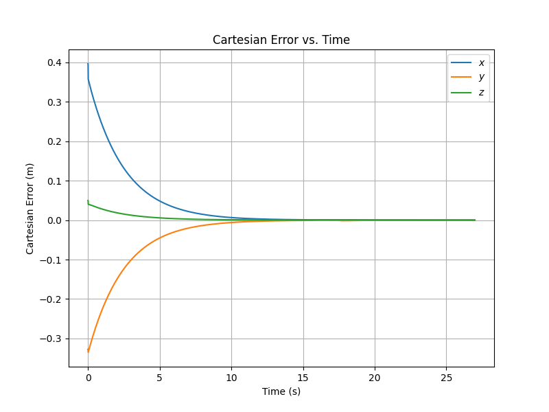
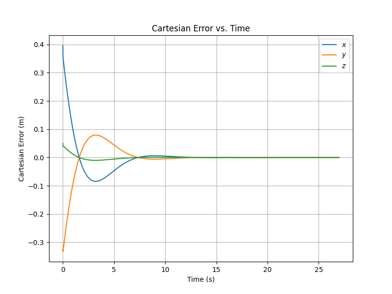
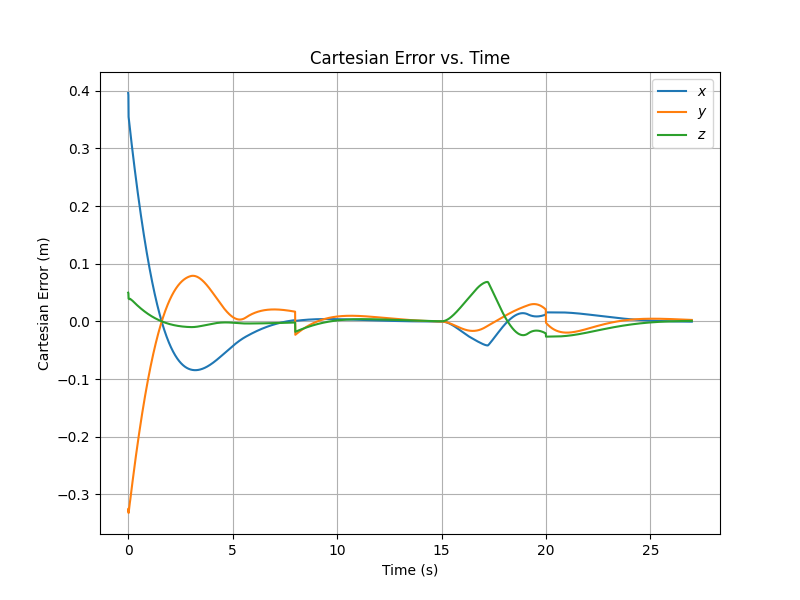

# Mobile Manipulation with a KUKA youBot (ME 449)

Final project for ME 449, Robotic Manipulation, at Northwestern University.
A simulated KUKA youBot (a four-mecanum-wheel base with a 5R arm) picks up a
cube and places it at a goal pose. The software plans the end-effector
trajectory, tracks it with feedforward plus PI control, and writes a CSV that
plays back in CoppeliaSim.

## How it works

| File | Role |
|---|---|
| `code/milestone1.py` | `NextState`: Euler integration of chassis, arm and wheel state with speed limits, using mecanum-wheel odometry. |
| `code/milestone2.py` | `TrajectoryGenerator`: eight-segment end-effector trajectory (standoff, grasp, lift, move, place) with gripper state. |
| `code/milestone3.py` | `FeedbackControl`: commanded twist `V = Ad(X⁻¹Xd)·Vd + Kp·Xerr + Ki·∫Xerr`. |
| `code/graph.py` | Simulation loop: forward kinematics, stacked chassis and arm Jacobian, pseudoinverse to wheel and joint speeds, CSV output and error plots. |
| `code/best.py`, `overshoot.py`, `newtask.py` | The three runs below. |

Rigid-body math (matrix log and exponential, adjoints, body Jacobian, forward
kinematics, Cartesian trajectories) comes from the
[Modern Robotics](https://github.com/NxRLab/ModernRobotics) Python library.

## Results

| Run | Gains | Cube start to goal | Error plot |
|---|---|---|---|
| best | Kp = 0.4, Ki = 0 | (1, 0, 0) to (0, -1, -π/2) |  |
| overshoot | Kp = 0.9, Ki = 0.5 | same |  |
| newtask | Kp = 0.9, Ki = 0.5 | (1.5, -0.5, π/4 intended) to (0.2, -1.2, -π/2) |  |

Each `results/` folder also has the angular error plot, the error CSV and the
13-column configuration CSV for CoppeliaSim.

## Limitations

- No joint-limit or self-collision avoidance; only wheel and joint speeds are
  clamped.
- `NextState` recovers the chassis heading with `arcsin`, so it is valid only
  while the heading stays within ±90°.
- `newtask.py` builds the cube's start rotation with a wrong angle in one
  entry, so the start orientation is not a valid π/4 rotation. The committed
  newtask results come from that code as submitted.

## Run

    pip install -r requirements.txt
    python3 code/best.py

Run from the repo root; the scripts write to `./results/<run>`.

## Stack

Python, NumPy, Matplotlib, Modern Robotics library, CoppeliaSim
